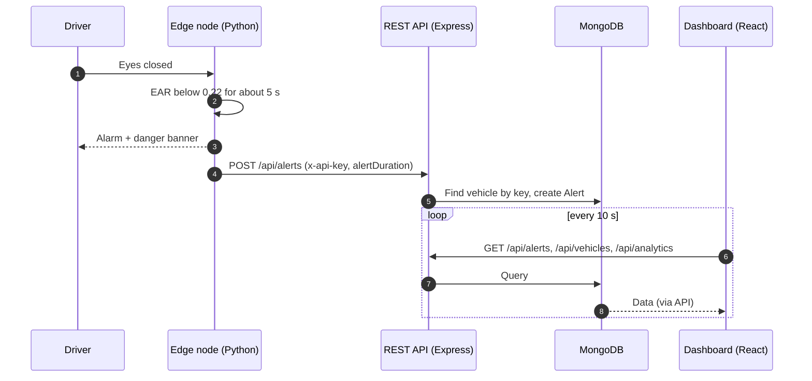
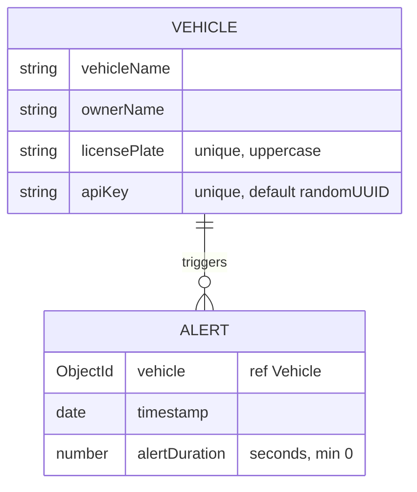

<p align="center">
  
</p>

<p align="center">
  
  
  
  
  
  
  
  
</p>

<p align="center"><b>A full-stack driver drowsiness detection system.</b><br/>
A webcam-based edge node spots prolonged eye closure, sounds a local alarm and reports the event to a REST API. A React dashboard shows alerts and vehicles.</p>

---

## Contents

[Features](#features) · [Architecture](#architecture) · [How detection works](#how-detection-works) · [Tech stack](#tech-stack) · [Project structure](#project-structure) · [Getting started](#getting-started) · [API reference](#api-reference) · [Data model](#data-model) · [Limitations](#limitations-and-roadmap) · [License](#license)

---

## Features

| | |
|---|---|
| **Real-time detection** | Reads webcam frames with OpenCV and finds facial landmarks with MediaPipe Face Landmarker. |
| **EAR-based eye tracking** | Computes the Eye Aspect Ratio for both eyes and averages it. Eyes count as closed below `EAR_THRESHOLD = 0.22`. |
| **FPS-adaptive timer** | The roughly 5-second closed-eye window is converted to a frame count from the measured frame rate. |
| **Non-blocking alarm** | A looping beep plays on a daemon thread, so the video loop never stalls. |
| **Debounced alerting** | One alert is sent per sleep event, then the detector re-arms when the eyes reopen. The POST runs on a background thread, and connection errors are logged instead of crashing the loop. |
| **On-screen HUD** | Eye contours, a red "DANGER: SLEEP DETECTED" banner and a heads-up display. |
| **Per-vehicle API keys** | Each registered vehicle gets a unique key (UUID). The edge node sends it in the `x-api-key` header, and the backend identifies the vehicle from it. |
| **Fleet dashboard** | KPI cards, an hourly-alerts chart, a vehicle grid, an alert table and a vehicle registration flow. Data refreshes every 10 seconds. |

## Architecture

<p align="center">
  
</p>



## How detection works

<p align="center">
  
</p>

1. OpenCV captures a frame from the webcam.
2. MediaPipe Face Landmarker returns facial landmarks.
3. The EAR is computed for each eye, then averaged.
4. If the EAR stays below the threshold for about 5 seconds, the alarm loops, a danger banner is drawn and a single alert is dispatched.
5. When the eyes reopen, the alarm stops and the alert flag resets for the next event.

## Tech stack

| Layer | Technology |
|---|---|
| Edge node | Python, `opencv-python`, `mediapipe`, `numpy`, `requests` |
| Backend | Node.js, Express 4, Mongoose 8, dotenv |
| Database | MongoDB |
| Dashboard | React 19, TypeScript, Vite, Tailwind CSS, Recharts, lucide-react |

## Project structure

```text
Drowsiness-Detection/
├── sleep_detection.py        # Edge node: detection, alarm, alert dispatch
├── requirements.txt          # Python dependencies
├── face_landmarker.task      # MediaPipe model (auto-downloaded if missing)
├── backend/
│   ├── server.js             # Express app entry point
│   ├── config/db.js          # MongoDB connection (reads MONGO_URI)
│   ├── controllers/          # alert, vehicle, analytics handlers
│   ├── models/               # Alert.js, Vehicle.js
│   ├── routes/               # alertRoutes, vehicleRoutes, analyticsRoutes
│   └── middleware/           # errorMiddleware.js
└── dashboard/
    └── src/
        ├── components/       # Dashboard, KpiGrid, HourlyAlertsChart, VehicleGrid, AlertTable, ...
        ├── hooks/            # useAlerts, useAnalytics, useVehicles
        └── types.ts, utils/
```

## Getting started

### Prerequisites

Python 3, Node.js and npm, a MongoDB database (a local instance or MongoDB Atlas) and a webcam. The edge node plays its alarm with `winsound`, so it currently runs on **Windows only**.

### 1. Backend

```bash
cd backend
npm install
```

Create `backend/.env`:

```env
MONGO_URI=<your MongoDB connection string>
PORT=5000
```

```bash
npm run dev      # nodemon; use `npm start` for plain node
```

The server health check is at `GET /`.

### 2. Dashboard

```bash
cd dashboard
npm install
npm run dev
```

Optionally set `VITE_API_BASE_URL` (for example `http://localhost:5000`). If it is unset, the dashboard calls `/api/...` on its own origin.

### 3. Register a vehicle and get its API key

Use the dashboard's vehicle registration form. A modal shows the new key once. Copy it.

### 4. Edge node

```bash
pip install -r requirements.txt
set SLEEP_API_URL=http://localhost:5000/api/alerts
set SLEEP_API_KEY=<your vehicle API key>
python sleep_detection.py
```

On first run the script downloads `face_landmarker.task` if it is missing. Press `q` to quit.

### Configuration

| Name | Where | Default | Meaning |
|---|---|---|---|
| `EAR_THRESHOLD` | `sleep_detection.py` | `0.22` | EAR below this counts as eyes closed |
| Alarm duration | `sleep_detection.py` | about 5 s | Closed-eye time before the alarm |
| `SLEEP_API_URL` | environment | none | Backend alerts endpoint |
| `SLEEP_API_KEY` | environment | placeholder | Vehicle API key |
| `MONGO_URI` | `backend/.env` | none (required) | MongoDB connection string |
| `PORT` | `backend/.env` | `5000` | API port |
| `VITE_API_BASE_URL` | dashboard env | empty | API base URL |

## API reference

| Method | Path | Description |
|---|---|---|
| `GET` | `/` | Health check (service name, status, version) |
| `POST` | `/api/alerts` | Create an alert. Header `x-api-key` is required. Body: `{ "alertDuration": <seconds, number ≥ 0> }`. Returns `201`. |
| `GET` | `/api/alerts` | List alerts, newest first, with vehicle name, owner and plate |
| `POST` | `/api/vehicles/register` | Register a vehicle. Body: `vehicleName`, `ownerName`, `licensePlate`. Returns `201`. Duplicate plates are rejected. |
| `GET` | `/api/vehicles` | List vehicles with a `totalAlerts` count per vehicle |
| `GET` | `/api/analytics` | `{ totalVehicles, totalAlerts, hourlyData: [{ hour, count }] }` |

Example alert request:

```bash
curl -X POST http://localhost:5000/api/alerts \
  -H "Content-Type: application/json" \
  -H "x-api-key: <vehicle api key>" \
  -d '{"alertDuration": 5.2}'
```

## Data model



## Screenshots

<!-- Add your own images to an `assets/` folder and uncomment:
<p align="center">
  
  
</p>
-->

*Screenshots of the detector HUD and the dashboard go here.*

## Limitations and roadmap

Being upfront about the current state:

- The edge node is Windows-only because of `winsound`.
- Eye closure is the only drowsiness signal. Yawning and head pose are not used.
- The read endpoints (`GET /api/alerts`, `/api/vehicles`, `/api/analytics`) have no authentication, and the dashboard sends no credentials.
- There are no automated tests yet.

Ideas for next steps:

- [ ] Cross-platform audio so the edge node also runs on Linux and macOS
- [ ] Authentication on dashboard endpoints, plus `helmet`, `cors` and rate limiting
- [ ] Pagination and filtering for alerts
- [ ] Unit tests for the EAR logic and API routes
- [ ] Docker Compose for backend, database and dashboard
- [ ] Additional signals such as yawning or head pose

> **Disclaimer:** This is a learning and demonstration project. It is not a certified safety system and must not be relied on to prevent accidents.

## License

Released under the MIT License. See [LICENSE](LICENSE).

## Author

**Vaidika Thakur**: [@codewith-vaidika](https://github.com/codewith-vaidika)
